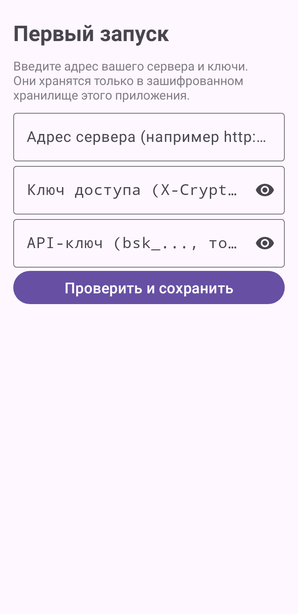
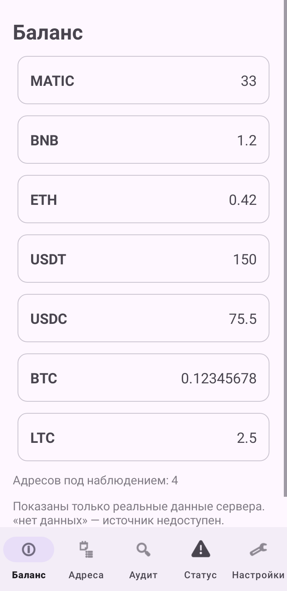
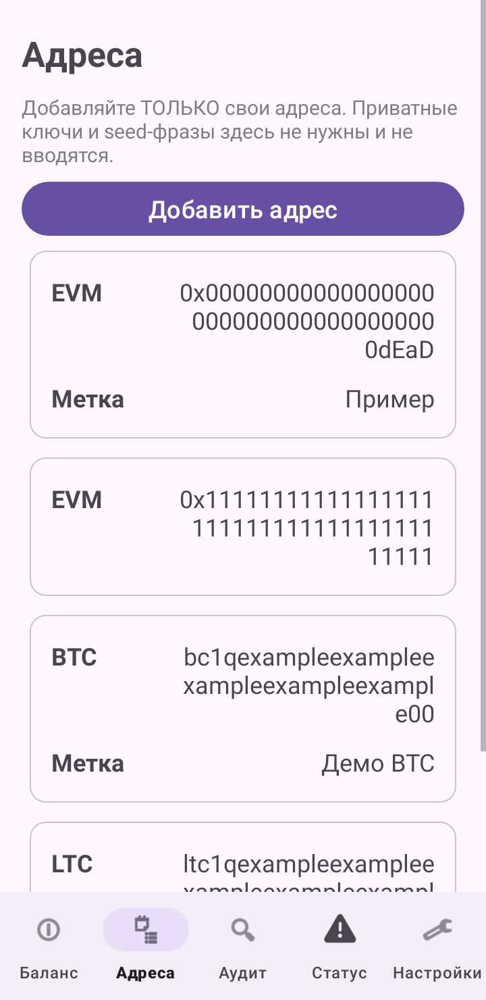
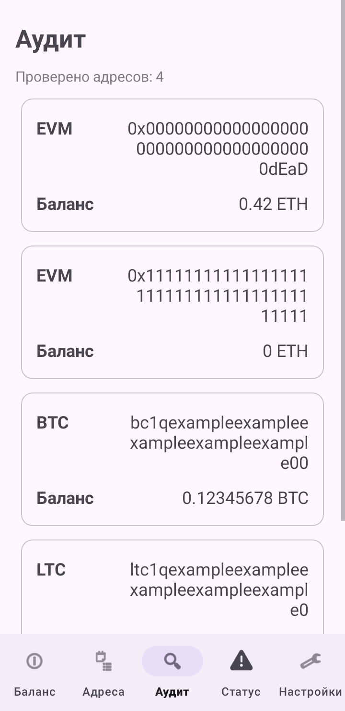
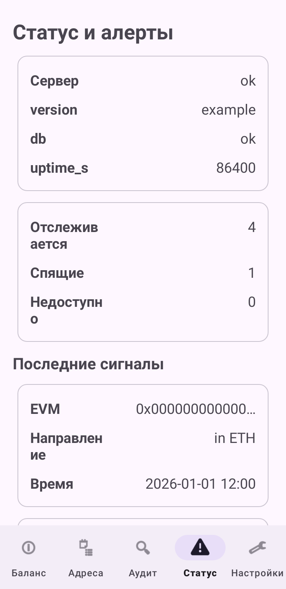
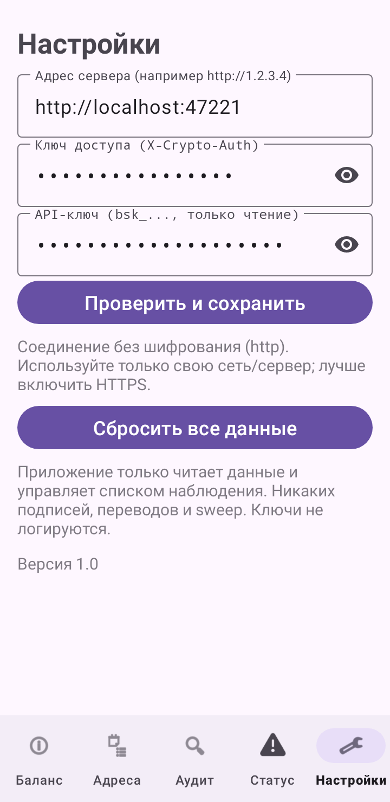

# CryptoSuite Simple

A small, watch-only Android client (Russian UI) for **your own** self-hosted `crypto_suite` backend. It shows balances, your watchlist, an audit of your addresses and the backend status. It never holds private keys.

> **Only add addresses you own.** This app is not a tool for scanning or tracking other people's wallets.

## Features

| Screen | What it does |
|---|---|
| Баланс | Totals for MATIC, BNB, ETH, USDT, USDC, BTC, LTC (BCH when non-zero). Empty balances show `0`; an unreachable source shows «нет данных». Nothing is invented. |
| Адреса | Your watchlist. Add an address (auto / btc / ltc / bch / evm); long-press to delete. |
| Аудит | One button runs the watchlist audit and lists the result per address. |
| Статус | Backend health, liquidity status, latest signals, dormant wallets. |
| Настройки | Edit the server URL and keys, or reset everything. |

Also: pull-to-refresh, plain-language error messages (no connection, wrong key, no permission, rate limit, server error), and a one-time, non-blocking warning on rooted devices.

## Security model

- No private keys, seed phrases, signing or sweeping in the app. All of that stays on your server.
- No hardcoded server URL, keys, tokens or addresses. On first launch you enter them; they are stored only in the app's private storage (Keystore-backed `EncryptedSharedPreferences`, with a private-mode fallback). Backups are disabled and logging is stripped in release builds.
- Cleartext HTTP is allowed because a backend may run without TLS. **Use HTTPS whenever you can**; Settings warns when the URL is `http://`.

## Requirements

- Android 8.0+ (minSdk 26)
- A running `crypto_suite` backend you control
- An API key (`bsk_…`). A read-only key is enough for viewing, audit and status; adding/removing addresses needs a key with `build` scope.
- If your backend sits behind a reverse proxy that requires an `X-Crypto-Auth` header, its value.

## Install

1. Build the APK (see below) or install one you built yourself.
2. Enable "install unknown apps" for your file manager or browser, open the APK and install it.
3. On first launch enter: server URL (e.g. `https://your-host`), the `X-Crypto-Auth` value (if used) and your `bsk_…` API key. The app checks `/api/health` before saving.

## Usage

- **Check balances:** open Баланс and pull down to refresh.
- **Add an address:** Адреса → Добавить → paste your own address → choose the chain or leave `auto`.
- **Run an audit:** Аудит → «Запустить аудит».
- **Read-only key:** add/delete returns «У ключа нет прав»; everything else keeps working.

## Backend endpoints used

`GET /api/health`, `GET /api/v1/watchlist/summary`, `GET /api/v1/evm/portfolio`, `GET /api/v1/watchlist`, `DELETE /api/v1/watchlist/{id}`, `POST /api/v1/import/watchlist`, `GET /api/v1/watchlist/audit`, `GET /api/v1/liquidity/status`, `GET /api/v1/liquidity/signals`, `GET /api/v1/liquidity/dormant`.

Every route except `/api/health` sends `X-API-Key`, plus `X-Crypto-Auth` when configured.

## Build from source

Requirements: JDK 17, Android SDK 34.

```bash
git clone https://github.com/theblaze156/cryptosuite-simple.git
cd cryptosuite-simple
# local.properties: sdk.dir=/path/to/Android/sdk
# keystore.properties (git-ignored): storeFile, storePassword, keyAlias, keyPassword
./gradlew testDebugUnitTest
./gradlew assembleRelease
```

Create your own keystore, for example with `keytool -genkeypair -v -keystore release.jks -alias app -keyalg RSA -keysize 2048 -validity 10000`. Never commit it.

## Contributing

Issues and pull requests are welcome; see [CONTRIBUTING.md](CONTRIBUTING.md). Report security problems privately, see [SECURITY.md](SECURITY.md).

## License

[MIT](LICENSE)

## Скриншоты / Screenshots

> Скриншоты сделаны на примерных данных, это не реальные кошельки. / Screenshots use example data, not real wallets.
> Рендер: Robolectric (`ScreenshotTest`, тестовый source set, в APK не попадает) с локальным mock-сервером.

| Первый запуск | Баланс | Адреса |
|---|---|---|
|  |  |  |
| **Аудит** | **Статус** | **Настройки** |
|  |  |  |
